# LAPORAN PRAKTIKUM PBO

## Identitas

| Data              | Keterangan                                          |
| ----------------- | --------------------------------------------------- |
| Nama              | Satria Mahardika                                    |
| NPM               | 4525210068                                          |
| Kelas             | A                                                   |
| Program Studi     | Teknik Informatika                                  |
| Mata Kuliah       | Pemrograman Berorientasi Objek                      |
| Materi Praktikum  | Exception Handling dan Pemrograman Defensif         |

---

## 1. Program Java

### 1.1 File `PerpustakaanException.java`

> File `PerpustakaanException.java` adalah kelas induk (*abstract class*) dari seluruh exception domain perpustakaan. Kelas ini diturunkan dari `RuntimeException` (*unchecked exception*) karena kegagalan seperti anggota atau buku tidak ditemukan menandakan permintaan yang tidak sah, bukan keadaan luar yang wajar terjadi. Dengan adanya induk bersama, pemanggil dapat menangkap seluruh kegagalan domain sekaligus melalui satu blok `catch` tanpa ikut menelan kesalahan pemrograman lainnya.

### Bukti Pengerjaan

* **Before / Kondisi awal:**

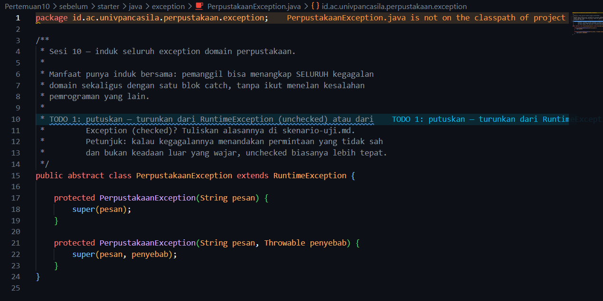

* **After / Kondisi setelah pengerjaan:**

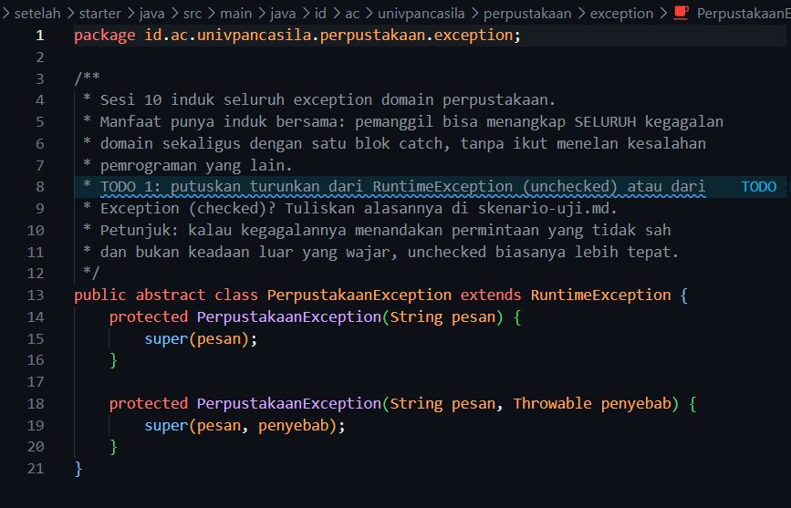

### 1.2 File `BukuTidakDitemukanException.java`

> File `BukuTidakDitemukanException.java` merupakan *custom exception* yang dilempar ketika ISBN buku tidak terdapat di katalog. Exception ini tidak hanya membawa pesan teks, tetapi juga **membawa data penyebab** berupa atribut `isbn` (`private final`) yang dapat diambil kembali melalui *getter* `getIsbn()`. Dengan begitu pemanggil tidak perlu mengurai kalimat pesan untuk mengetahui ISBN yang bermasalah.

### Bukti Pengerjaan

* **Before / Kondisi awal:**

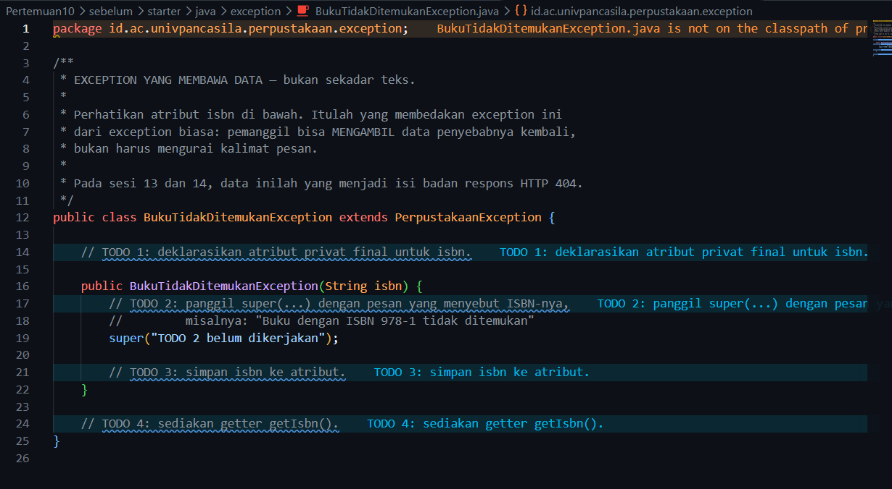

* **After / Kondisi setelah pengerjaan:**

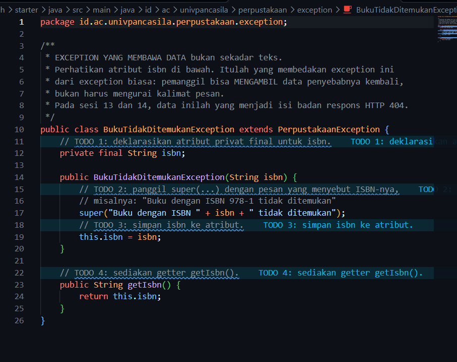

### 1.3 File `AnggotaTidakDitemukanException.java`

> File `AnggotaTidakDitemukanException.java` dilempar ketika ID anggota belum terdaftar di sistem. Mengikuti pola `BukuTidakDitemukanException`, exception ini menyimpan atribut `idAnggota` beserta *getter* `getIdAnggota()` sehingga data penyebab kegagalan dapat dimanfaatkan kembali oleh pemanggil.

### Bukti Pengerjaan

* **Before / Kondisi awal:**

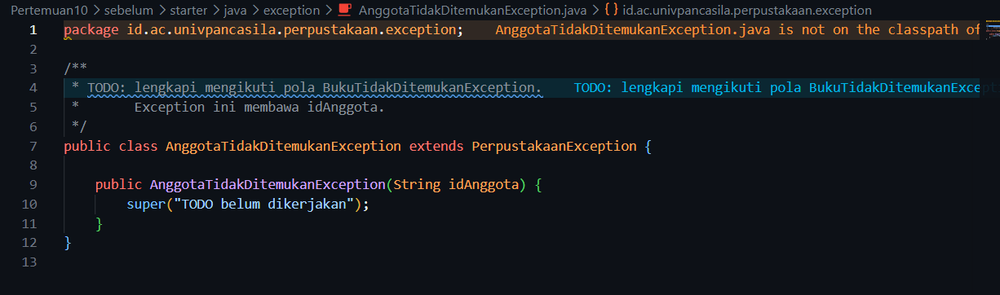

* **After / Kondisi setelah pengerjaan:**

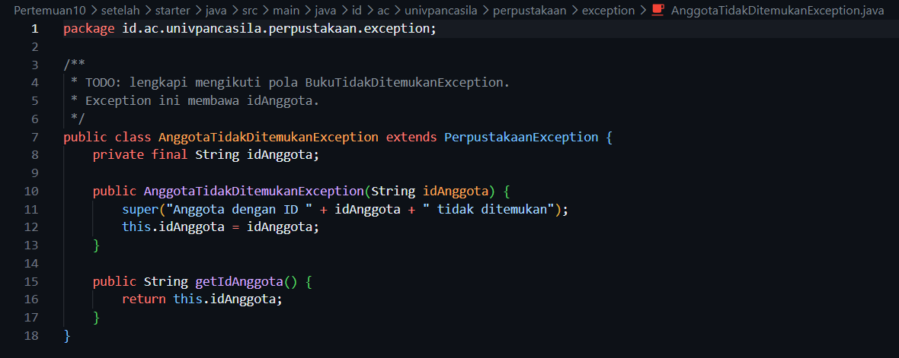

### 1.4 File `BukuSedangDipinjamException.java`

> File `BukuSedangDipinjamException.java` dilempar ketika stok eksemplar suatu buku sudah habis. Exception ini membawa **dua data**, yaitu `isbn` agar dapat diolah oleh sistem, dan `judul` agar pesan yang ditampilkan kepada pengguna lebih bermakna. Keduanya dapat diakses melalui `getIsbn()` dan `getJudul()`.

### Bukti Pengerjaan

* **Before / Kondisi awal:**

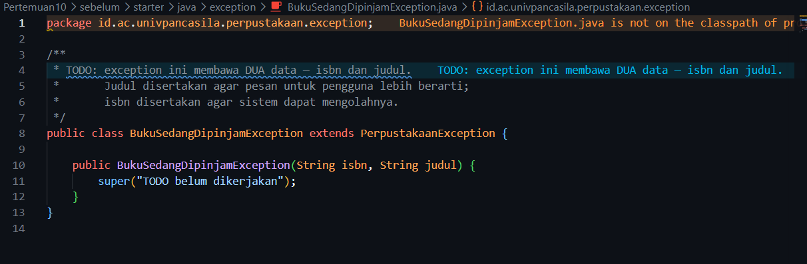

* **After / Kondisi setelah pengerjaan:**

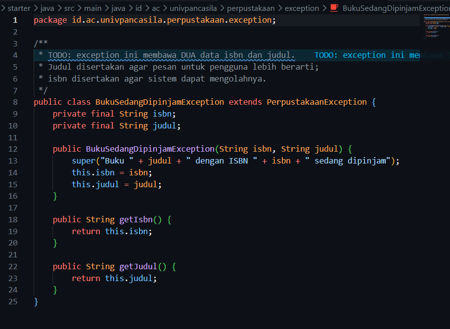

### 1.5 File `BatasPinjamTerlampauiException.java`

> File `BatasPinjamTerlampauiException.java` dilempar ketika anggota telah mencapai batas maksimum peminjaman (3 buku). Exception ini membawa `idAnggota` dan `batas`, sehingga pemanggil dapat menyusun pesan kesalahan tanpa harus mengetahui aturan batas pinjam secara langsung.

### Bukti Pengerjaan

* **Before / Kondisi awal:**

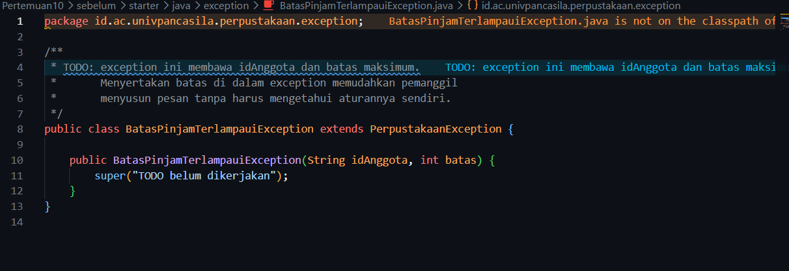

* **After / Kondisi setelah pengerjaan:**

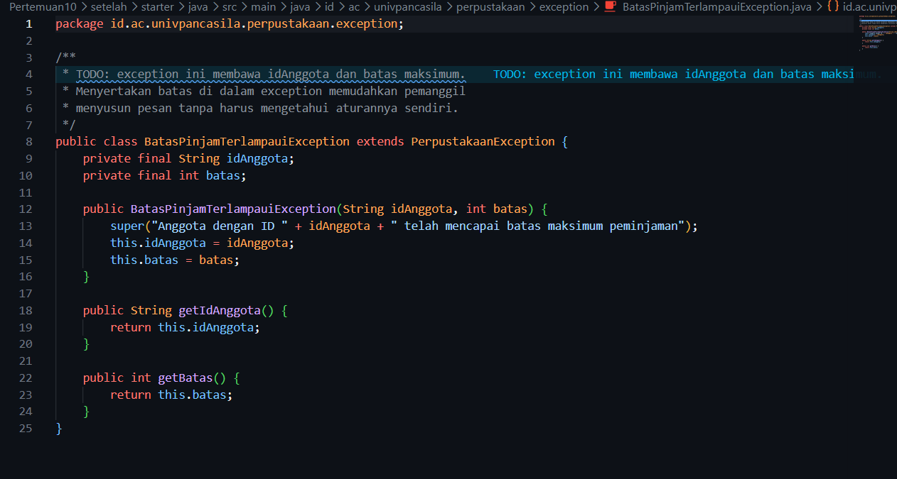

### 1.6 File `LibraryServiceKotor.java` dan `LibraryService.java`

> File `LibraryServiceKotor.java` adalah bahan refactoring yang method `pinjam()`-nya bersarang **empat tingkat** `if-else` dan hanya mengembalikan `false` tanpa memberi tahu alasan kegagalan. File `LibraryService.java` adalah hasil refaktor menggunakan pola ***guard clause***: setiap kondisi tidak sah diperiksa lebih dahulu dan langsung melempar exception yang sesuai (`AnggotaTidakDitemukanException`, `BukuTidakDitemukanException`, `BukuSedangDipinjamException`, `BatasPinjamTerlampauiException`). Logika utama (mengurangi stok dan menambah jumlah pinjaman) berada di akhir method tanpa penjorokan, sehingga alur lebih mudah dibaca, pemanggil mengetahui alasan kegagalan, dan aturan baru mudah ditambahkan. Kedua file dipertahankan untuk keperluan perbandingan saat demo.

### Bukti Pengerjaan

* **Before / Kondisi awal (`LibraryServiceKotor.java`):**

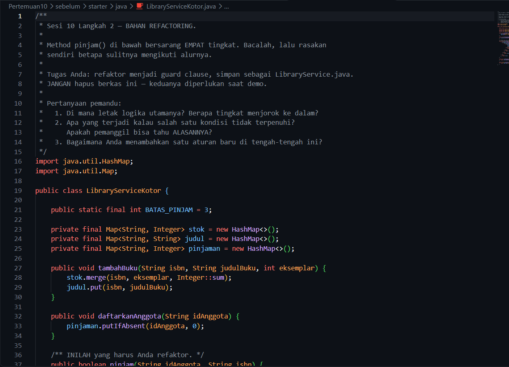

* **After / Kondisi setelah pengerjaan (`LibraryServiceKotor.java`):**

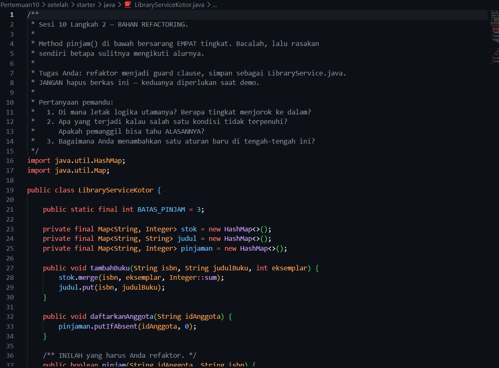

### 1.7 File `PerpustakaanService.java`

> File `PerpustakaanService.java` berisi method-method *static* yang menangani interaksi pengguna (`tambahBuku`, `tambahAnggota`, `pinjamBuku`). Penerapan pemrograman defensif terlihat pada validasi input kosong, validasi angka dengan `NumberFormatException`, dan blok `try-catch` bertingkat pada `pinjamBuku`. Blok `catch (PerpustakaanException e)` menangani seluruh kegagalan domain, lalu `instanceof` digunakan untuk mengambil data spesifik dari tiap exception (ISBN, ID anggota, judul, atau batas). Blok `catch (Exception e)` terakhir menangani kesalahan tak terduga.

### Bukti Pengerjaan

* **After / Kondisi setelah pengerjaan (`PerpustakaanService.java`):**

### 1.8 File `Main.java`

> File `Main.java` berfungsi sebagai kelas penggerak (*driver class*) yang menampilkan menu interaktif sistem perpustakaan (Tambah Buku, Tambah Anggota, Pinjam Buku, Keluar). Setelah pengguna keluar, method `eksporLaporan()` menulis daftar buku beserta stok dan statusnya ke berkas `laporan_buku.txt` menggunakan ***try-with-resources*** sehingga `PrintWriter` otomatis ditutup meskipun terjadi kesalahan, dan `IOException` ditangani dengan pesan yang jelas.

### Bukti Pengerjaan

* **After / Kondisi setelah pengerjaan:**

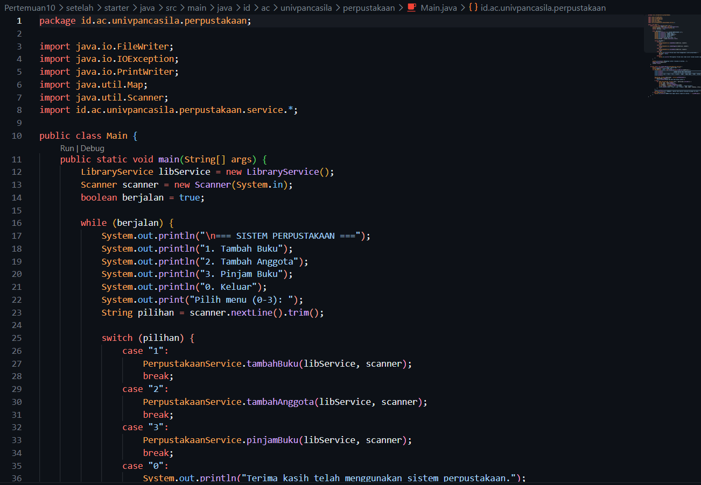

* **Output setelah pengerjaan:**

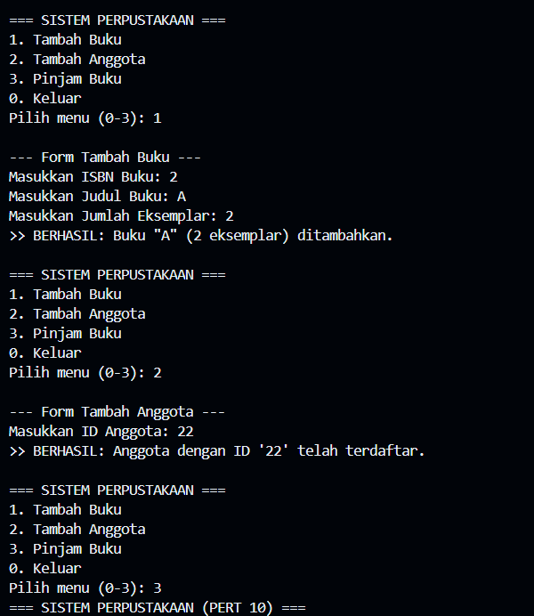

---

## 2. Program PHP

### 2.1 File `exceptions.php` / `src/Exception/`

> Pada versi awal, seluruh kelas exception berada dalam satu file `exceptions.php`. Setelah pengerjaan, kelas tersebut dipecah menjadi satu file per kelas di dalam folder `src/Exception/` dengan *namespace* `Perpustakaan\Exception` dan dimuat otomatis melalui *autoload* Composer (PSR-4). Induk `PerpustakaanException` diturunkan dari `RuntimeException`. Karena PHP tidak mengenal *checked exception*, anotasi `@throws` pada PHPDoc menjadi sangat penting sebagai dokumentasi bagi pembaca kode. Exception turunan (`BukuTidakDitemukanException`, `AnggotaTidakDitemukanException`, `BukuSedangDipinjamException`, `BatasPinjamTerlampauiException`) memakai ***constructor property promotion*** dengan properti `private readonly` serta *getter* masing-masing.

### Bukti Pengerjaan

* **Before / Kondisi awal (`exceptions.php`):**

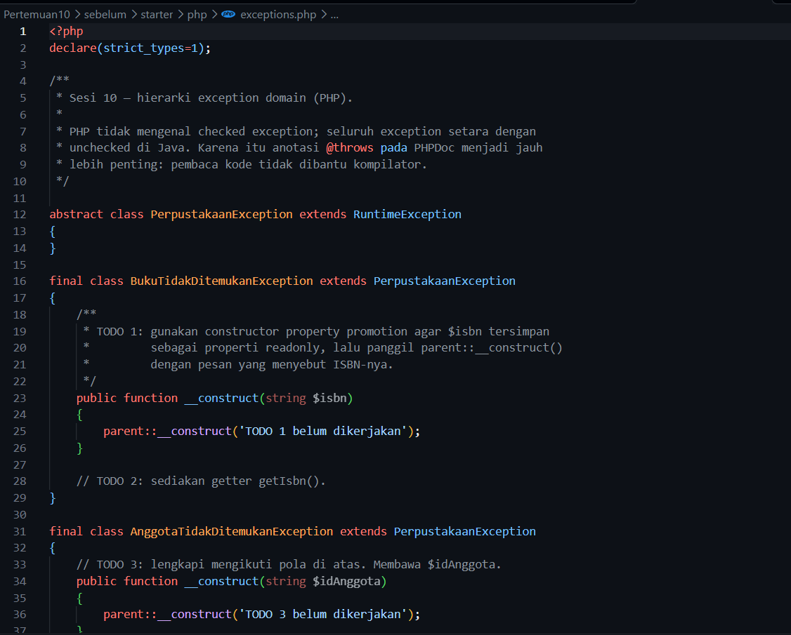

* **After / Kondisi setelah pengerjaan (`Exceptions.php`):**

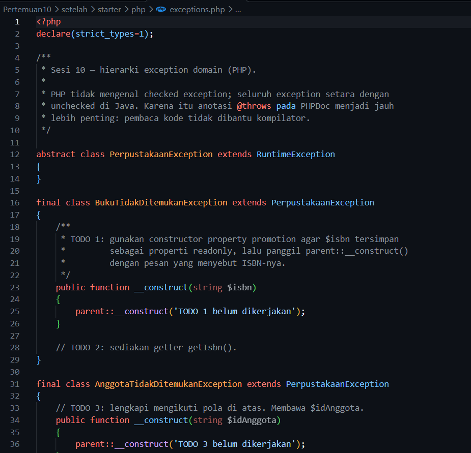

* **After / `PerpustakaanException.php`:**

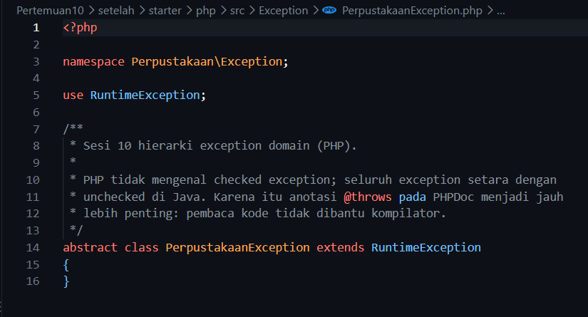

* **After / `BukuTidakDitemukanException.php`:**

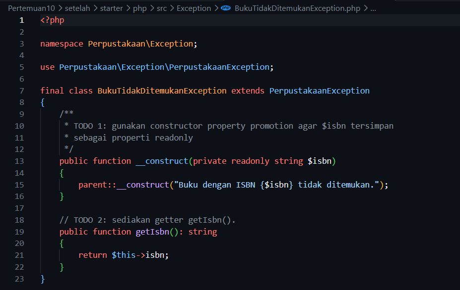

* **After / `AnggotaTidakDitemukanException.php`:**

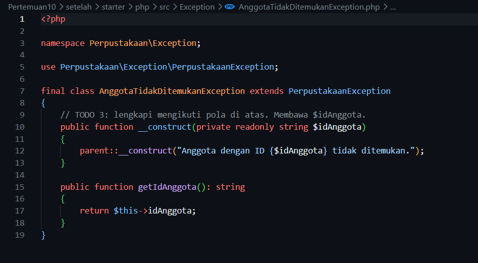

* **After / `BukuSedangDipinjamException.php`:**

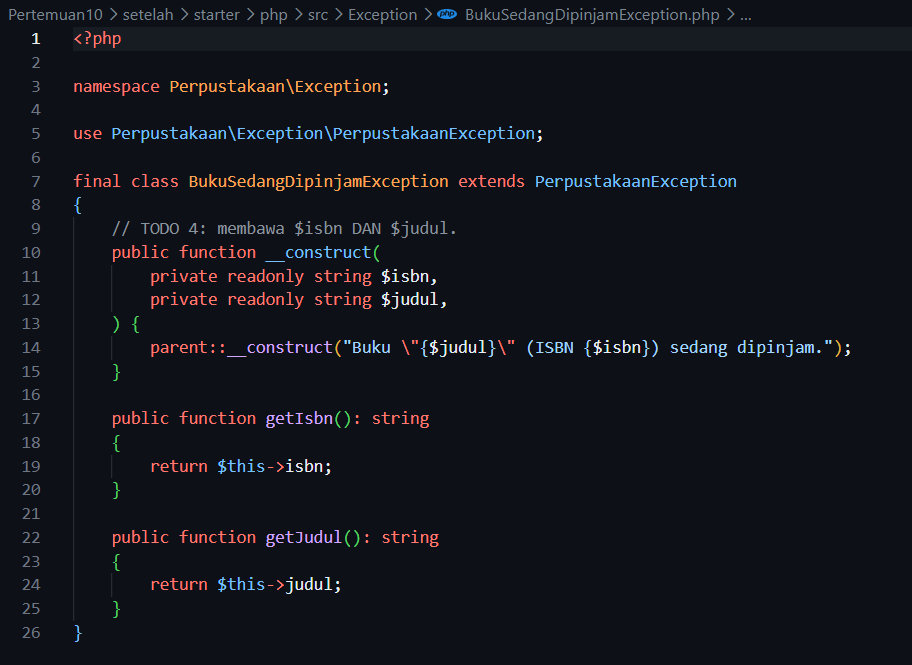

* **After / `BatasPinjamTerlampauiException.php`:**

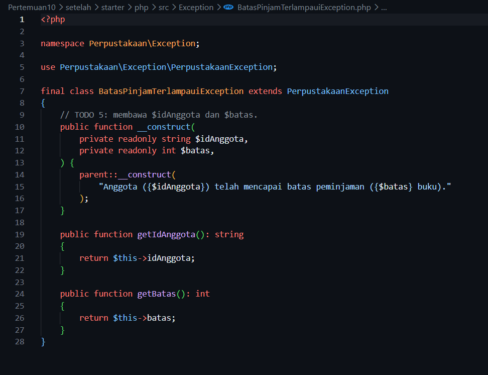

### 2.2 File `LibraryServiceKotor.php` dan `LibraryService.php`

> File `LibraryServiceKotor.php` adalah versi awal dengan `if` bersarang dan nilai kembalian boolean tanpa alasan kegagalan. File `LibraryService.php` adalah versi refaktor yang menerapkan ***guard clause***: method `pinjam()` bertipe kembalian `void` dan melempar exception domain yang sesuai (`AnggotaTidakDitemukanException`, `BukuTidakDitemukanException`, `BukuSedangDipinjamException`, `BatasPinjamTerlampauiException`) saat syarat tidak terpenuhi, dengan dokumentasi `@throws` pada PHPDoc. Kelas dideklarasikan `final` dan konstanta `BATAS_PINJAM = 3` bertipe `int`.

### Bukti Pengerjaan

* **Before / Kondisi awal (`LibraryServiceKotor.php`):**

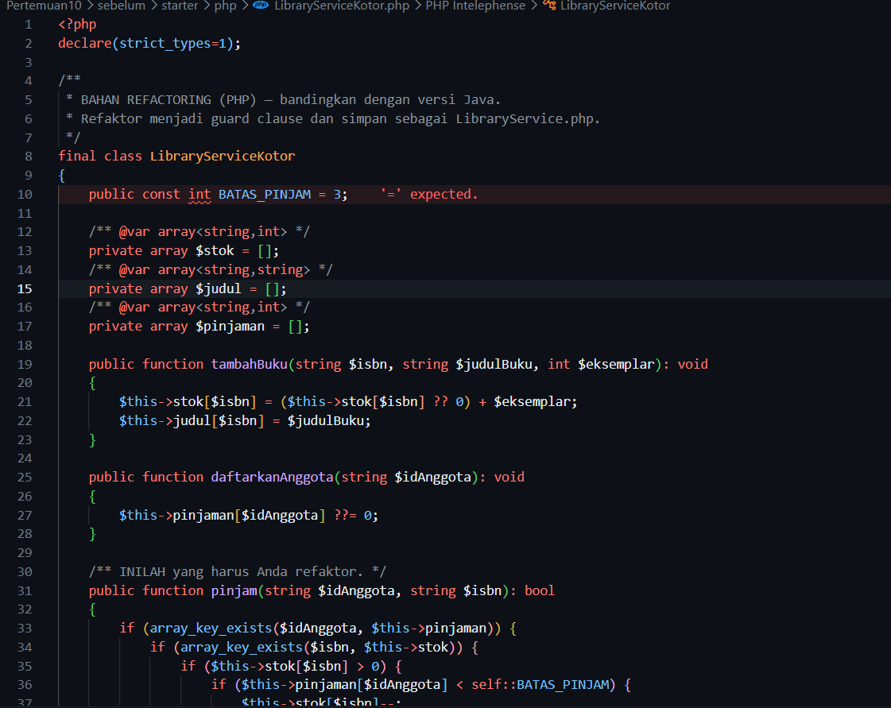

* **After / `LibraryServiceKotor.php` (dipertahankan untuk demo):**

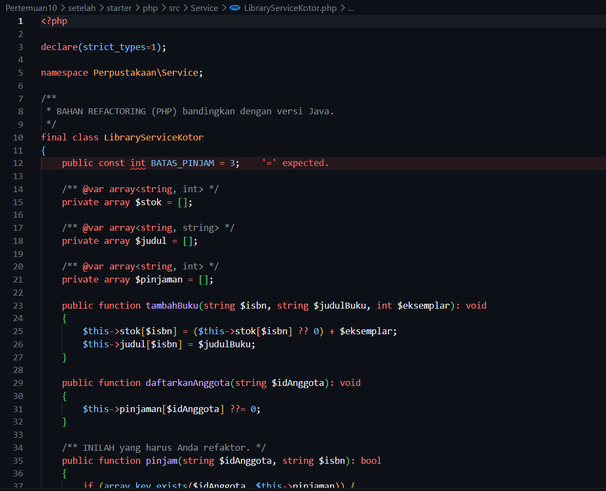

* **After / Kondisi setelah pengerjaan (`LibraryService.php`):**

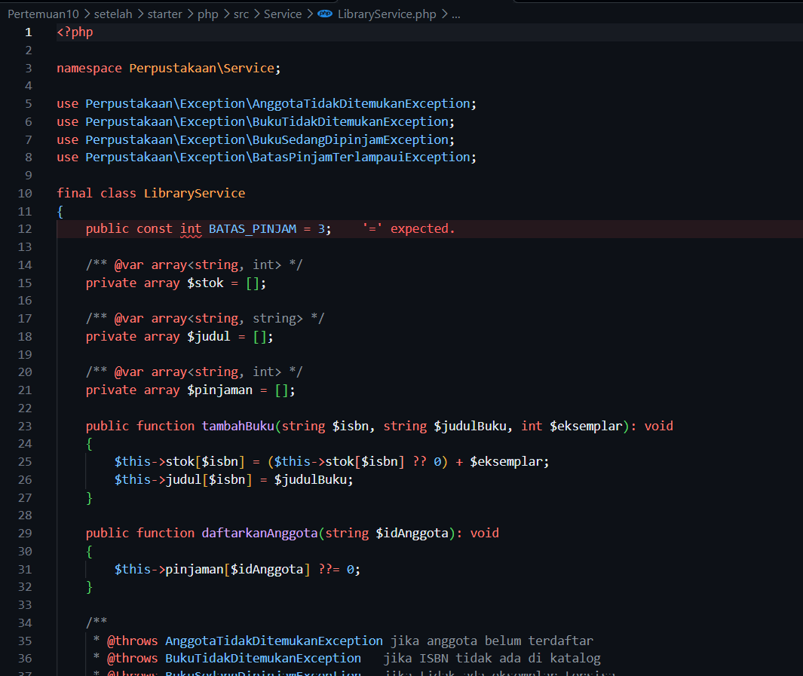

### 2.3 File `Main.php`

> File `Main.php` bertindak sebagai *script* eksekusi utama. Script memuat *autoload* Composer, membuat objek `LibraryService`, menambahkan dua buku dan dua anggota, lalu menjalankan tujuh skenario peminjaman: berhasil, buku habis, buku tidak ada, anggota tidak terdaftar, dan batas pinjam tercapai. Setiap percobaan dibungkus `try-catch` yang menangkap `PerpustakaanException`. Fungsi `createReport()` mengekspor laporan ke `laporan_buku.txt` dan memakai blok `finally` agar *file handle* selalu ditutup dengan aman, apa pun yang terjadi di tengah proses penulisan.

### Bukti Pengerjaan

* **After / Kondisi setelah pengerjaan:**

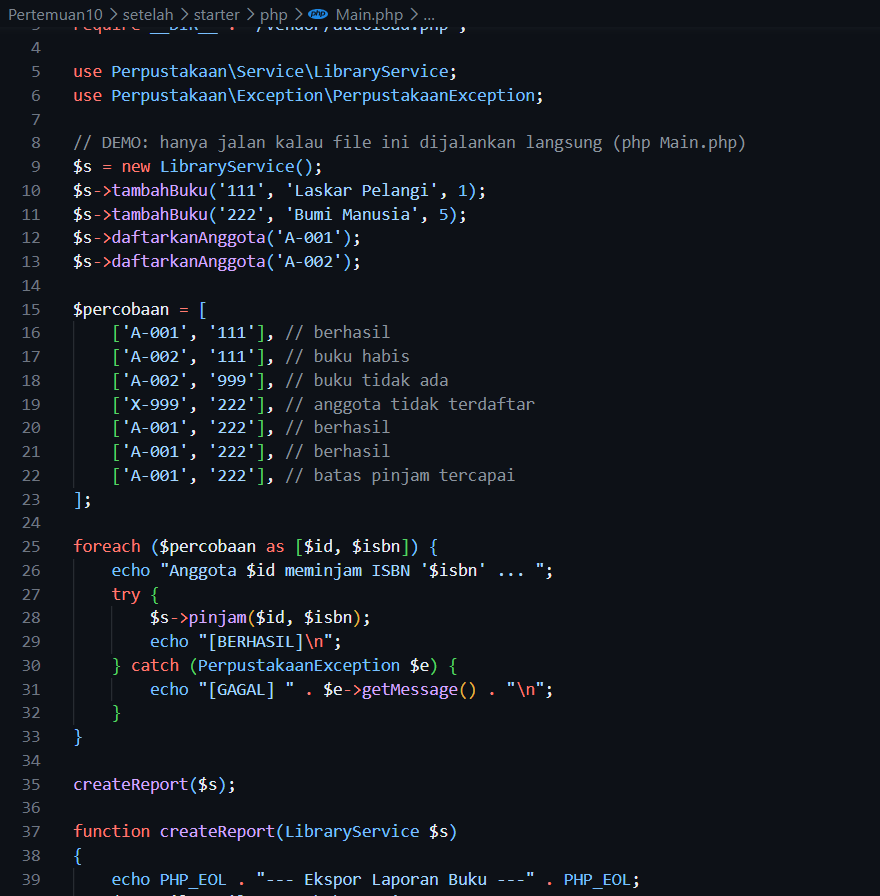

* **Output setelah pengerjaan:**

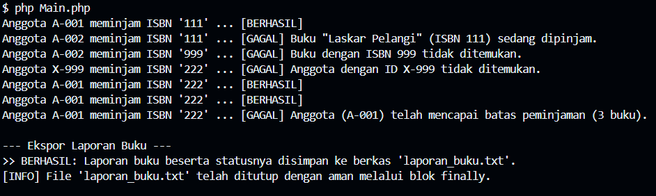

---

## Kesimpulan

> Praktikum ini memberikan pemahaman mengenai *exception handling* dan pemrograman defensif melalui studi kasus sistem peminjaman buku perpustakaan. Hal-hal yang dipelajari meliputi pembuatan hierarki *custom exception* dengan induk bersama (`PerpustakaanException`), exception yang membawa data penyebab (ISBN, ID anggota, judul, batas pinjam) sehingga pemanggil tidak perlu mengurai teks pesan, serta refactoring `if` bersarang menjadi ***guard clause*** yang melempar exception sehingga alasan kegagalan selalu jelas. Penanganan sumber daya juga dipraktikkan dengan *try-with-resources* pada **Java** dan blok `finally` pada **PHP** agar berkas selalu tertutup dengan aman. Perbandingan kedua bahasa menunjukkan bahwa prinsip pemrograman defensif bersifat universal. Perbedaannya, Java mengenal *checked* dan *unchecked exception* yang diperiksa kompilator, sedangkan PHP tidak sehingga dokumentasi `@throws` menjadi lebih penting.
