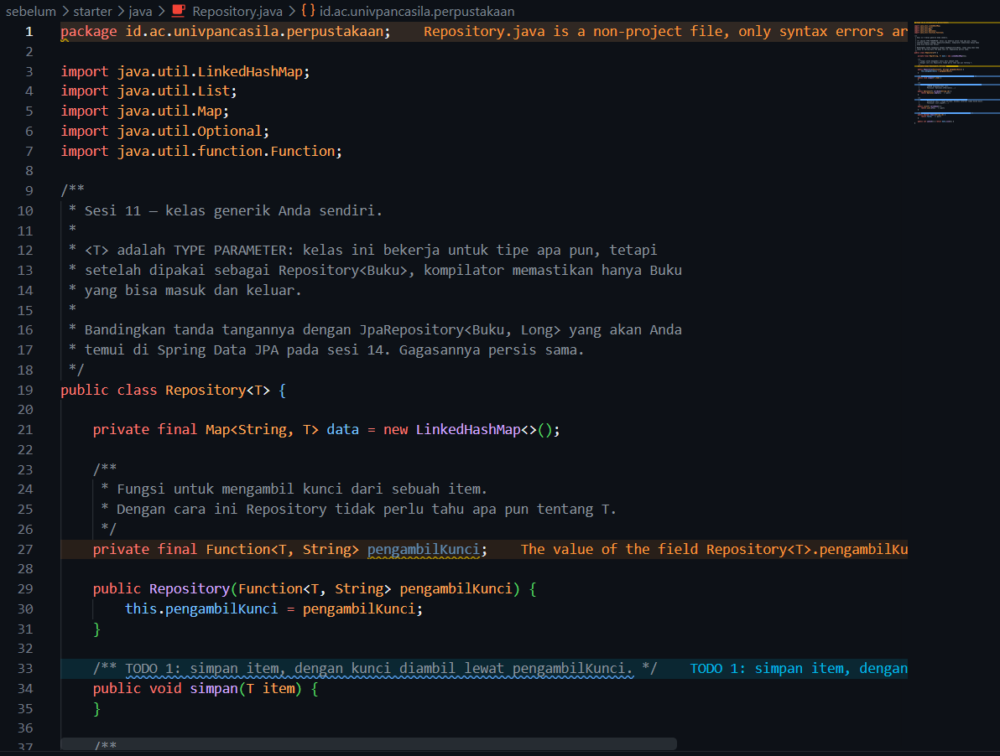
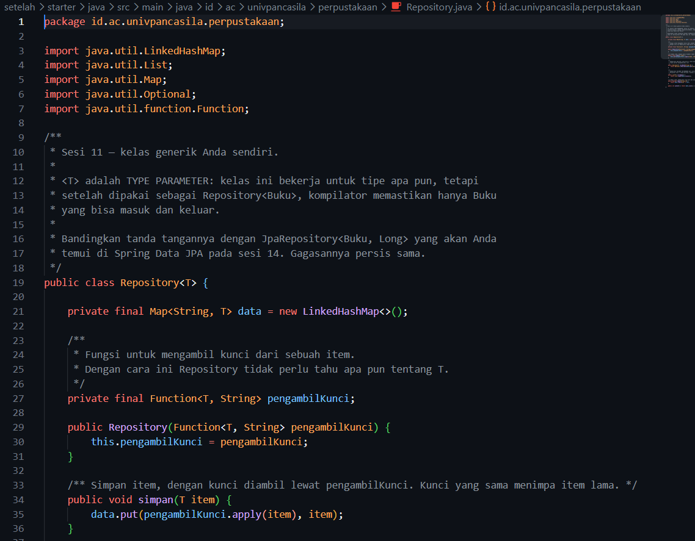

# LAPORAN PRAKTIKUM PBO

## Identitas

| Data              | Keterangan                                          |
| ----------------- | --------------------------------------------------- |
| Nama              | Satria Mahardika                                    |
| NPM               | 4525210068                                          |
| Kelas             | A                                                   |
| Program Studi     | Teknik Informatika                                  |
| Mata Kuliah       | Pemrograman Berorientasi Objek                      |
| Materi Praktikum  | Collections, Generics, dan Operasi Fungsional         |

---

## Ringkasan Konsep Praktikum

1. **Collections (Wadah Data):**
   * **List (`ArrayList` / array berindeks):** Menyimpan data secara berurutan dan memperbolehkan duplikasi (seperti antrean atau riwayat).
   * **Set (`HashSet` / kunci array):** Menyimpan data unik tanpa duplikasi (seperti daftar NIM atau ID anggota).
   * **Map (`HashMap` / array asosiatif):** Menyimpan pasangan *Kunci → Nilai* (seperti `ISBN → Buku`) untuk pencarian instan tanpa memeriksa elemen satu per satu.
2. **Generics & Padanannya:**
   * **Java:** Memberikan label tipe (`Repository<T>`) sehingga kesalahan tipe data ditolak sejak tahap kompilasi sebelum program dijalankan, serta mendukung *Bounded Type* dan *Wildcard* (**PECS**: *Producer Extends, Consumer Super*).
   * **PHP:** Tidak memiliki *generics* bawaan, sehingga keamanan tipe diterapkan melalui **PHPDoc** (`@return Buku[]`), **Typed Collection** (kelas pembungkus seperti `KoleksiBuku`), dan **Union Type** (`int|float`).
3. **Penanganan Nilai Kosong (`Optional` vs *Nullable*):**
   * **Java:** Menggunakan `Optional<T>` (`.map(...).orElse(...)`) untuk mencegah `NullPointerException`.
   * **PHP:** Menggunakan *null-safe operator* (`?->`) dan *null coalescing operator* (`??`).
4. **Operasi Fungsional:** Mengolah koleksi secara deklaratif tanpa perulangan `for` manual menggunakan operasi **Filter** (menyaring), **Map** (mengubah), **Reduce** (meringkas), dan **GroupingBy** (mengelompokkan).
5. **Unit Testing:** Pengujian otomatis dengan alur **Siapkan (*Arrange*) → Jalankan (*Act*) → Periksa (*Assert*)** untuk memverifikasi perilaku kelas dan skenario error dari sesi sebelumnya.

---

## 1. Program Java

### 1.1 File `Repository.java`

> File `Repository.java` adalah kelas generik `Repository<T>` yang menggunakan *type parameter* `T` untuk menyimpan dan mengelola berbagai entitas domain (seperti `Buku` dan `Anggota`) dengan aman tanpa risiko `ClassCastException`. Di dalamnya digunakan struktur `Map` agar pencarian berdasarkan kunci (ID/ISBN) berjalan cepat, serta menyediakan method standar seperti `simpan(T item)`, `cariById(String id)` yang mengembalikan `Optional<T>`, `cariSemua()` yang mengembalikan `List<T>` tak dapat diubah, dan `hapus(String id)`.

### Bukti Pengerjaan

* **Before / Kondisi awal:**



* **After / Kondisi setelah pengerjaan:**



### 1.2 File `LibraryService.java`

> Pada lapisan layanan bisnis, pengelolaan data koleksi memanfaatkan `Repository<T>`, `Optional<T>` untuk menangani kasus buku atau anggota yang tidak ditemukan secara aman, serta **Java Stream API** (`.filter()`, `.map()`, `.reduce()`, `Collectors.groupingBy()`) untuk menyaring, mengubah, meringkas, dan mengelompokkan data koleksi buku maupun peminjaman secara deklaratif.

### Bukti Pengerjaan


* **After / Kondisi setelah pengerjaan (`LibraryService.java`):**


### 1.3 File `Main.java`

> File `Main.java` berfungsi sebagai program utama (*driver class*) yang mendemonstrasikan penggunaan `Repository<Buku>` dan `Repository<Anggota>`, penanganan hasil pencarian menggunakan `Optional` (`.orElse(...)`), serta menampilkan hasil pengolahan data fungsional pada sistem perpustakaan.

### Bukti Pengerjaan

* **After / Kondisi setelah pengerjaan (`Main.java`):**


### 1.4 File `RepositoryTest.java`

> File `RepositoryTest.java` berisi sekumpulan *unit test* (JUnit) untuk menguji fungsionalitas `Repository<T>` serta skenario layanan perpustakaan (seperti simpan data, cari berdasarkan ID yang ada maupun kosong, hapus data, hingga kasus error seperti ISBN tidak ada, ID anggota salah, stok habis, dan batas pinjam terlampaui) dengan pola tiga langkah: Siapkan, Jalankan, dan Periksa.

### Bukti Pengerjaan

* **After / Kondisi setelah pengerjaan (`RepositoryTest.java`):**


* **Output Program & Hasil Unit Test Java:**


---

## 2. Program PHP

### 2.1 File `KoleksiBuku.php` (`src/Model/`)

> Karena PHP tidak memiliki fitur *generics* bawaan, file `KoleksiBuku.php` diterapkan sebagai **Typed Collection** (kelas pembungkus khusus) yang memvalidasi tipe objek `Buku` pada saat penyimpanan (`simpan(Buku $b)`), dilengkapi dengan anotasi **PHPDoc** (`/** @return Buku[] */`) untuk mendukung analisis statis IDE. Data di dalamnya disimpan dalam *array asosiatif* berbasis kunci ISBN agar pencarian berlangsung cepat, serta menerapkan operasi fungsional PHP seperti `array_values(array_filter(...))`, `array_map(...)`, dan `array_reduce(...)`.

### Bukti Pengerjaan

* **Before / Kondisi awal (`KoleksiBuku.php`):**


* **After / Kondisi setelah pengerjaan (`KoleksiBuku.php`):**


### 2.2 File `main.php`

> File `main.php` memanfaatkan `KoleksiBuku` serta fitur *nullable* modern PHP yaitu *null-safe operator* (`?->`) dan *null coalescing operator* (`??`) saat mengakses properti objek yang mungkin kosong (contoh: `$koleksi->cariByIsbn('999')?->getJudul() ?? '(tidak ada)'`), sehingga terhindar dari error akses pada nilai `null`.

### Bukti Pengerjaan

* **After / Kondisi setelah pengerjaan (`main.php`):**


### 2.3 File `KoleksiBukuTest.php` (`tests/`)

> File `KoleksiBukuTest.php` merupakan pengujian otomatis menggunakan **PHPUnit** yang memverifikasi perilaku *Typed Collection* `KoleksiBuku` dan logika peminjaman perpustakaan (penambahan buku, pencarian ISBN yang ada dan tidak ada, penyaringan/operasi fungsional koleksi, serta pengecekan eksepsi saat stok habis atau batas pinjam terlampaui).

### Bukti Pengerjaan

* **After / Kondisi setelah pengerjaan (`KoleksiBukuTest.php`):**


* **Output Program & Hasil PHPUnit:**


---

## Cara Menjalankan & Pengujian

### Java (Maven)
```bash
cd java
mvn test
mvn exec:java -Dexec.mainClass="id.ac.univpancasila.perpustakaan.Main"
```

### PHP (Composer & PHPUnit)
```bash
cd php
composer install
vendor/bin/phpunit
php main.php
```

---

## Kesimpulan

> Praktikum Pertemuan 11 memberikan pemahaman mengenai pengelolaan kumpulan data yang aman dan ekspresif menggunakan **Collections**, **Generics**, **Optional/Nullable**, **Operasi Fungsional**, dan **Unit Testing**. Melalui perbandingan antara **Java** dan **PHP**, terlihat bahwa pemilihan struktur koleksi yang tepat (seperti `Map` atau *array asosiatif* untuk pencarian berbasis kunci) meningkatkan efisiensi akses data. Java menjamin keamanan tipe sejak waktu kompilasi melalui *Generics* (`Repository<T>`) dan menghindari `NullPointerException` dengan `Optional<T>`, sedangkan PHP mengatasinya pada waktu eksekusi melalui *Typed Collection* (`KoleksiBuku`), dokumentasi PHPDoc, serta operator `?->` dan `??`. Selain itu, operasi fungsional (*filter*, *map*, *reduce*) membuat pengolahan data lebih ringkas dan mudah dibaca, sementara *unit test* memastikan seluruh aturan bisnis dan penanganan error berjalan konsisten tanpa regresi.