# LAPORAN PRAKTIKUM PEMROGRAMAN BERBASIS OBJEK

| Informasi Praktikan | Keterangan |
| :--- | :--- |
| **Nama** | Satria Mahardika |
| **NPM** | 4525210068 |
| **Kelas** | A |
| **Mata Kuliah** | Pemrograman Berbasis Objek (PBO) |
| **Pertemuan** | 12 — REFACTORING & DESIGN PATTERNS |
| **Tanggal** | Kamis, 19 November 2026|

---

Pada modul praktikum pertemuan ke-12 ini, fokus utama pembelajaran adalah melakukan pembenahan struktur kode (*refactoring*) pada sistem manajemen perpustakaan berbasis Java dan PHP. Tujuan dari pembersihan kode ini adalah untuk menerapkan prinsip-prinsip *Clean Code* serta menyematkan beberapa pola desain (*Design Patterns*) standar industri tanpa merusak atau mengubah fungsionalitas bisnis yang sudah ada sebelumnya.

Dua pola desain utama yang diterapkan meliputi:
1. **Repository Pattern:** Memisahkan lapisan akses data (penyimpanan dan pencarian koleksi buku) dari logika layanan utama (*Business Logic*).
2. **Strategy Pattern & Factory Pattern:** Mengeliminasi penggunaan percabangan logika `if-else` atau `switch` yang menumpuk dalam perhitungan denda keterlambatan, menggantinya dengan polimorfisme kelas-kelas strategi terenkapsulasi yang dikelola secara terpusat oleh sebuah *factory*.

Berikut adalah penjabaran detail dari proses perombakan kode serta analisis file-file yang dikerjakan.

---

## 1. Implementasi Pemrograman Berbasis Objek Berbasis Java (Maven)

Pada project Java yang menggunakan struktur *package* `id.ac.univpancasila.perpustakaan`, perbaikan kode dilakukan secara bertahap mulai dari antarmuka denda, pembuatan strategi denda turunan, pemisahan *repository*, hingga pengujian melalui eksekusi Maven.

### 1.1. `AturanDenda.java`

**Analisis & Penjelasan Kode:**

Antarmuka (*interface*) `AturanDenda` bertindak sebagai kontrak utama yang mendefinisikan perilaku standar untuk kalkulasi denda keterlambatan pengembalian buku. Dengan menerapkan *Strategy Pattern*, kelas ini memastikan bahwa setiap algoritma perhitungan denda memiliki signature yang seragam, sehingga modul lain dapat memanggil fungsi terkait secara independen tanpa perlu tahu rincian implementasi di baliknya. Dua method esensial yang dideklarasikan adalah fungsi `hitung()` untuk kalkulasi nominal berdasarkan durasi keterlambatan, serta fungsi `nama()` untuk keperluan pelaporan antarmuka.

**Keadaan Sebelum Refactoring:**

File ini masih menyisakan catatan *TODO* sisa kerangka praktikum serta komentar panduan implementasi kode.

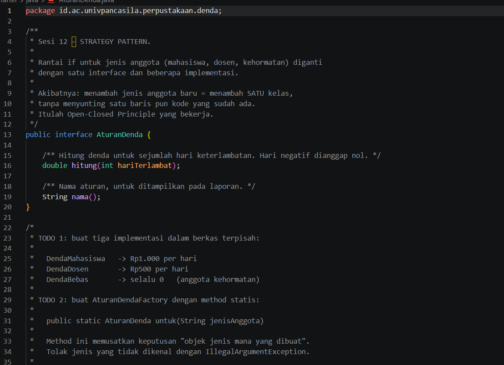

**Keadaan Sesudah Refactoring:**

Seluruh komentar *TODO* dibersihkan, menghasilkan struktur antarmuka yang bersih, ringkas, dan siap diimplementasikan oleh kelas strategi konkret.

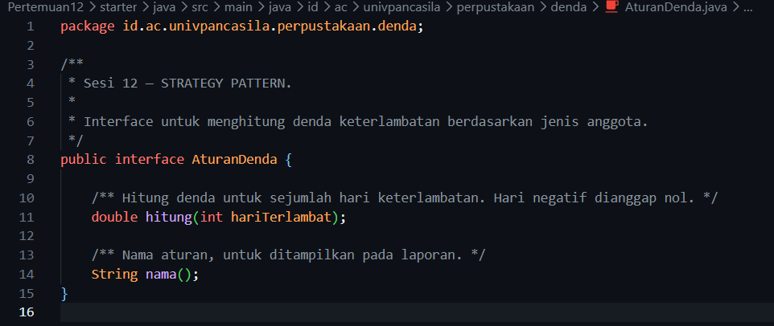

---

### 1.2. `AturanDendaFactory.java`

**Analisis & Penjelasan Kode:**

Kelas pabrik (*Factory Class*) ini dirancang untuk mereduksi kopling ketat dengan menerapkan *Factory Design Pattern*. Alih-alih membuat objek strategi denda secara manual di berbagai tempat, fungsi statis `untuk(String jenisAnggota)` dalam kelas ini bertugas menerima parameter kategori keanggotaan, menormalkannya menggunakan fungsi pembersih string (`trim().toLowerCase()`), lalu mengembalikan instansiasi kelas strategi yang sesuai (seperti `DendaMahasiswa`, `DendaDosen`, dll.). Konstruktor dibuat privat untuk mencegah instansiasi objek yang tidak perlu.

**Keadaan Sebelum Refactoring:**

Merupakan file komponen baru yang ditambahkan pada sesi pertemuan 12 ini.

**Keadaan Sesudah Refactoring:**

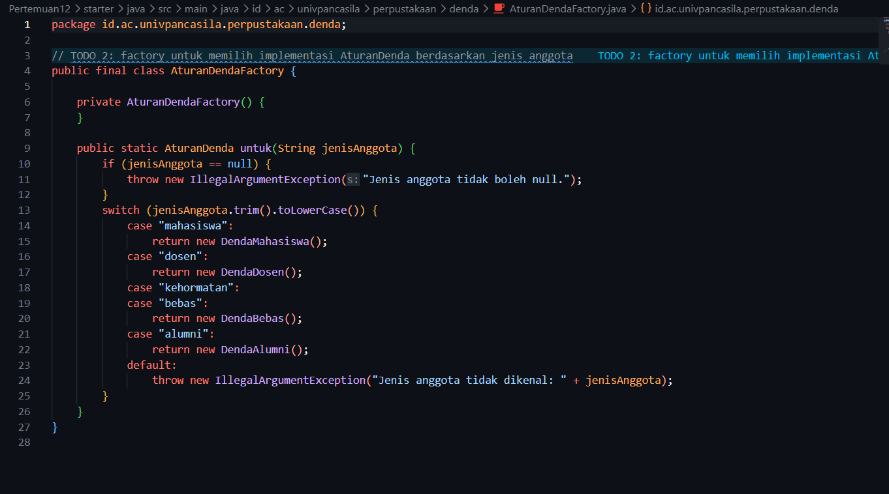

---

### 1.3. `DendaMahasiswa.java`

**Analisis & Penjelasan Kode:**

Kelas konkret turunan dari `AturanDenda` yang memuat logika spesifik tarif denda bagi kalangan mahasiswa, yakni senilai **Rp1.000 per hari keterlambatan**. Penggunaan fungsi pengaman `Math.max(0, hariTerlambat)` diterapkan guna menjamin bahwa input hari negatif (pengembalian lebih awal) tidak mengakibatkan kalkulasi denda bernilai negatif.

**Keadaan Sebelum Refactoring:**

Merupakan file komponen baru yang ditambahkan pada sesi pertemuan 12 ini.

**Keadaan Sesudah Refactoring:**

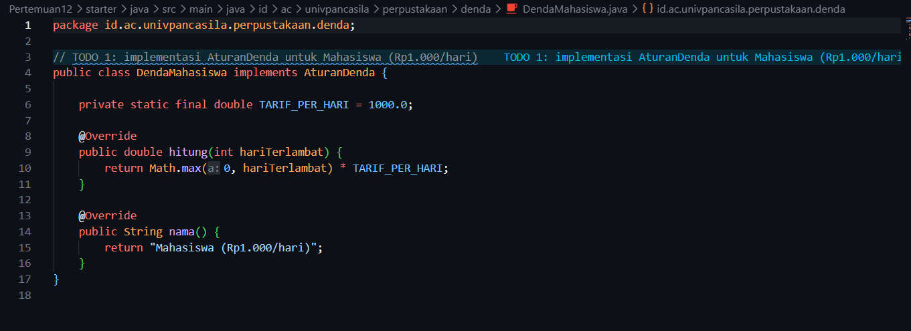

---

### 1.4. `DendaDosen.java`

**Analisis & Penjelasan Kode:**

Serupa dengan strategi mahasiswa, kelas ini merepresentasikan kebijakan khusus golongan pengajar/dosen dengan tarif diskon khusus sebesar **Rp500 per hari**. Berkat penerapan antarmuka yang seragam, kelas layanan dapat bertukar strategi perhitungan ini secara dinamis.

**Keadaan Sebelum Refactoring:**

Merupakan file komponen baru yang ditambahkan pada sesi pertemuan 12 ini.

**Keadaan Sesudah Refactoring:**

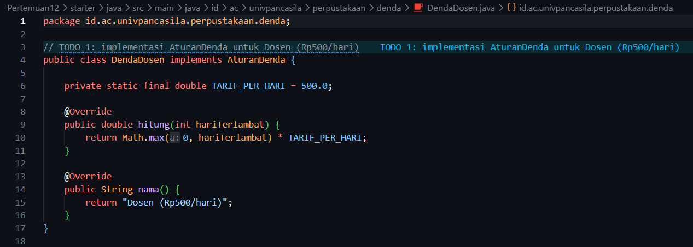

---

### 1.5. `DendaBebas.java`

**Analisis & Penjelasan Kode:**

Kelas strategi denda khusus yang diterapkan untuk anggota berstatus kehormatan. Implementasi method `hitung()` secara konsisten mengembalikan nilai `0.0` berapapun akumulasi hari keterlambatannya, mencerminkan fleksibilitas penanganan aturan bisnis yang bervariasi tanpa mengubah kode inti aplikasi.

**Keadaan Sebelum Refactoring:**

Merupakan file komponen baru yang ditambahkan pada sesi pertemuan 12 ini.

**Keadaan Sesudah Refactoring:**

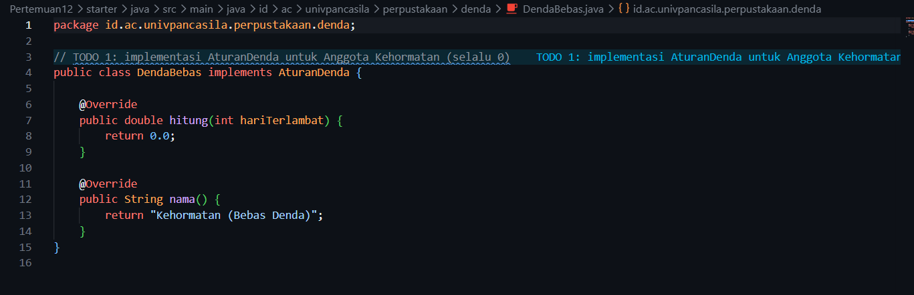

---

### 1.6. `DendaAlumni.java`

**Analisis & Penjelasan Kode:**

Keberadaan kelas ini membuktikan implementasi prinsip **Open-Closed Principle (OCP)** dari SOLID Design Principles. Ketika sistem harus mengakomodasi jenis anggota baru berupa alumni dengan tarif **Rp750 per hari**, pengembang tidak perlu memodifikasi kode kelas utama yang sudah berjalan, cukup membuat kelas strategi baru ini dan mendaftarkannya pada *factory*.

**Keadaan Sebelum Refactoring:**

Merupakan file komponen baru yang ditambahkan pada sesi pertemuan 12 ini.

**Keadaan Sesudah Refactoring:**

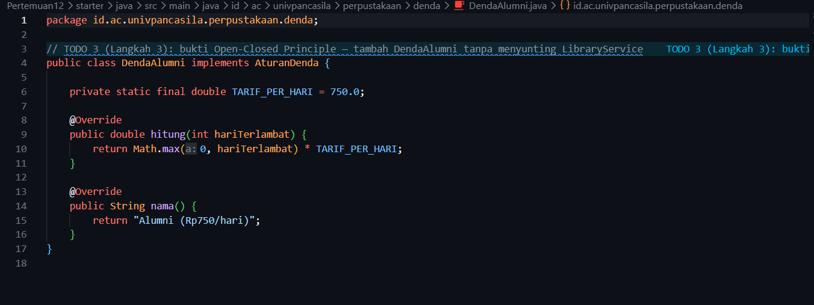

---

### 1.7. `BookRepository.java`

**Analisis & Penjelasan Kode:**

*Interface* ini bertindak sebagai lapisan abstraksi data buku (*Data Access Abstraction*). Dengan mendefinisikan method standar seperti `simpan()`, `cariByIsbn()`, `cariSemua()`, dan `kurangiStok()`, kelas logika bisnis (*Service*) tidak bergantung pada teknologi penyimpanan fisik tertentu (apakah itu struktur memori lokal, berkas teks, ataupun basis data relasional SQL). Penggunaan pembungkus `Optional` pada pencarian ISBN juga meminimalisir risiko galat `NullPointerException`.

**Keadaan Sebelum Refactoring:**

Masih berupa kerangka kosong dengan anotasi komentar *TODO*.

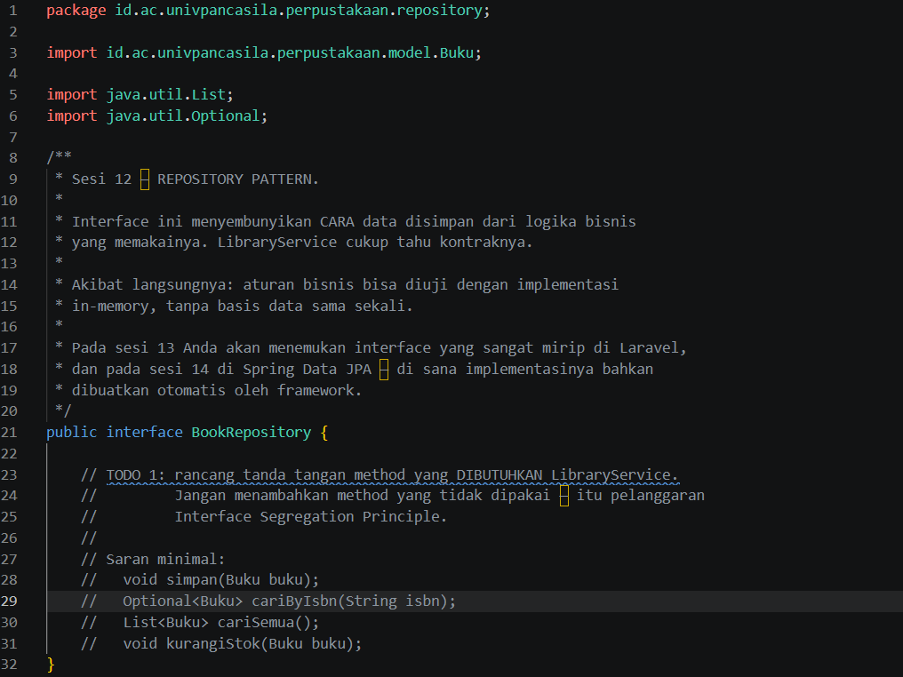

**Keadaan Sesudah Refactoring:**

Kontrak method repositori tersusun lengkap dan terstandarisasi.

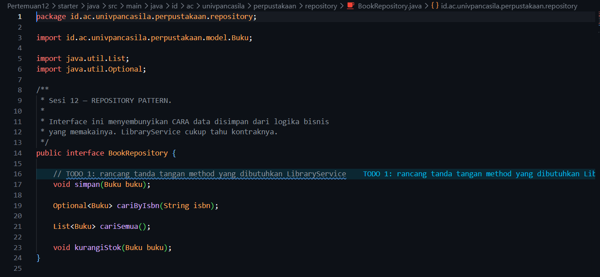

---

### 1.8. `InMemoryBookRepository.java`

**Analisis & Penjelasan Kode:**

Kelas ini merupakan implementasi nyata dari `BookRepository` yang memanfaatkan struktur data berbasis memori penampung `LinkedHashMap`. Pendekatan ini sangat efektif untuk keperluan pengujian unit (*unit testing*) dan simulasi sistem tanpa ketergantungan *database server* eksternal. Penggunaan fungsi `Collections.unmodifiableList` pada method `cariSemua()` juga menjamin keamanan integritas data koleksi agar tidak bisa dimodifikasi secara sembarangan dari luar kelas repositori.

**Keadaan Sebelum Refactoring:**

Masih berupa kerangka kelas mentah dengan struktur penyimpanan peta data yang belum diimplementasikan fungsinya.

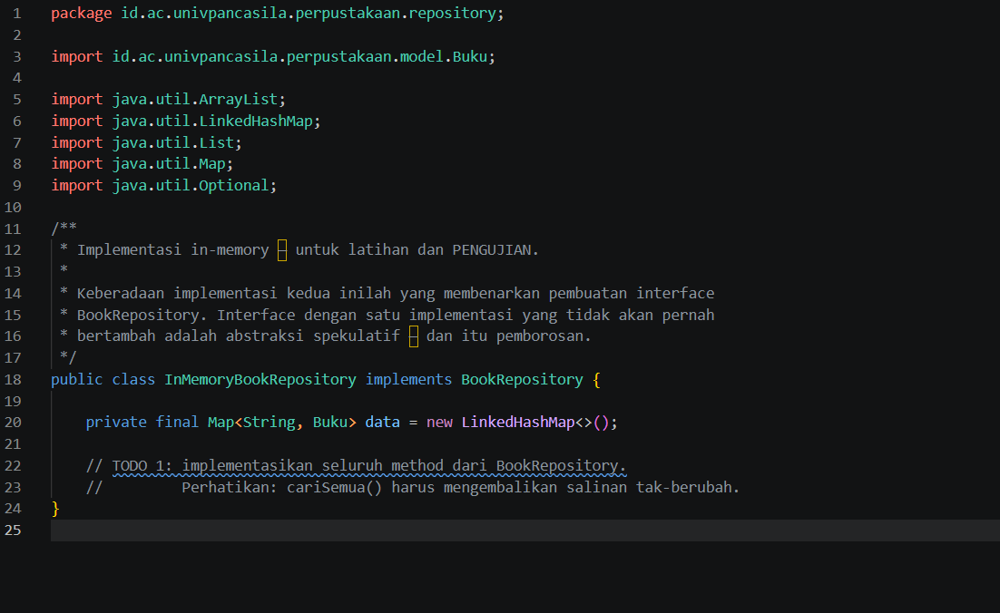

**Keadaan Sesudah Refactoring:**

Seluruh logika manipulasi data memori tertulis secara komprehensif.

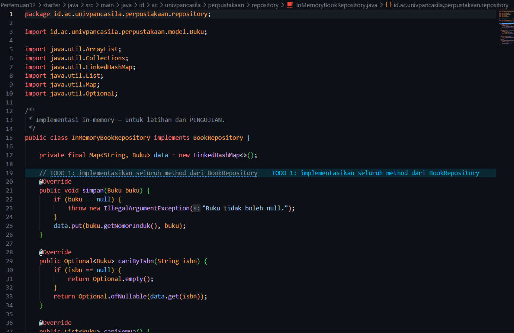

---

### Hasil Eksekusi Program Java

Program dijalankan dengan perintah Maven `mvn exec:java` dari folder `Pertemuan12/starter/java`. Konsol menampilkan menu utama "SISTEM PERPUSTAKAAN" dengan aturan denda aktif **Mahasiswa (Rp1.000/hari)**, yang dipilih lewat `AturanDendaFactory`. Pada eksekusi ini dicoba tiga hal:
- **Menu 1 (Tambah Buku):** buku dengan ISBN `1`, judul `a`, penulis `s`, dan 2 eksemplar berhasil ditambahkan ke repository.
- **Menu 2 (Tambah Anggota):** anggota dengan ID `68` berhasil didaftarkan.
- **Menu 3 (Pinjam Buku):** menu peminjaman dipilih setelah buku dan anggota tersedia.

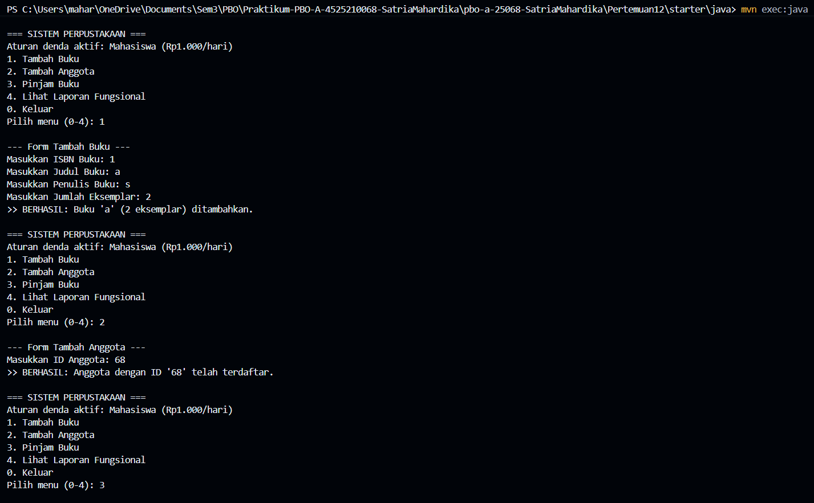

---

## 2. Implementasi Pemrograman Berbasis Objek Berbasis PHP

Pada environment PHP, perbaikan arsitektur kode dilakukan dengan memecah file monolitik (`repository.php`) ke dalam struktur direktori modular `src/Repository` dengan penerapan *namespace* standar (`Perpustakaan/Repository` dan `Perpustakaan/Model`).

### 2.1. `BookRepository.php` (PHP)

**Analisis & Penjelasan Kode:**

Kontrak antarmuka repositori versi PHP dengan penerapan *strict typing* (`declare(strict_types=1);`). Penulisan tanda tanya di depan tipe data (`?Buku`) menunjukkan bahwa fungsi pencarian mendukung pengembalian nilai `null` apabila entri buku berdasarkan ISBN yang dicari nihil di dalam sistem.

**Keadaan Sebelum Refactoring:**

Seluruh antarmuka dan implementasi masih tercampur di dalam satu file tunggal `repository.php` yang dipenuhi catatan *TODO*.

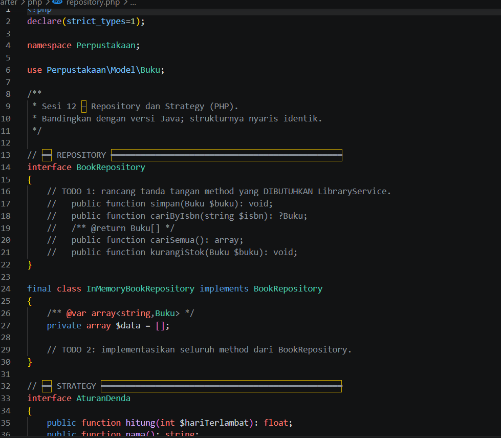

**Keadaan Sesudah Refactoring:**

Interface berhasil dipisahkan secara bersih ke dalam file `BookRepository.php`.

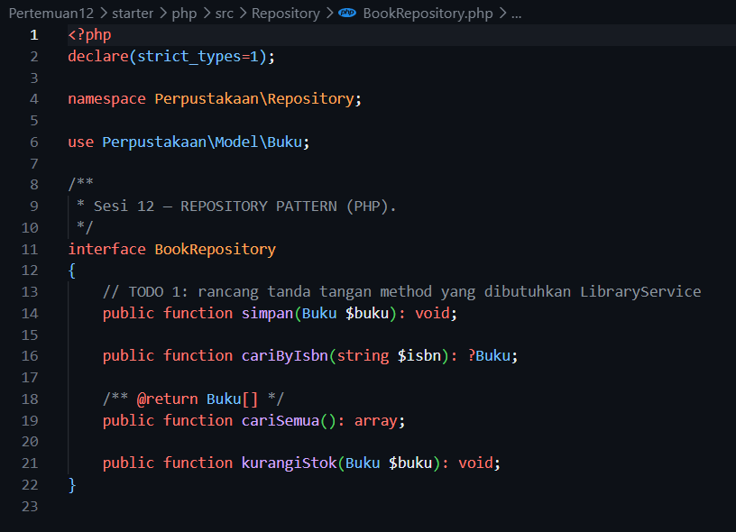

---

### 2.2. `InMemoryBookRepository.php` (PHP)

**Analisis & Penjelasan Kode:**

Kelas penyimpanan berbasis array internal PHP yang dideklarasikan dengan modifier `final` agar strukturnya aman dari pewarisan tak terduga. Pemanfaatan operator coalescing (`??`) mempercepat pencarian data ISBN, serta penggunaan `array_values()` memastikan pengembalian kumpulan data koleksi buku tersusun rapi secara berurutan.

**Keadaan Sebelum Refactoring:**

Berada di dalam file monolitik lama tanpa kelengkapan isi logika method penyimpanan.

**Keadaan Sesudah Refactoring:**

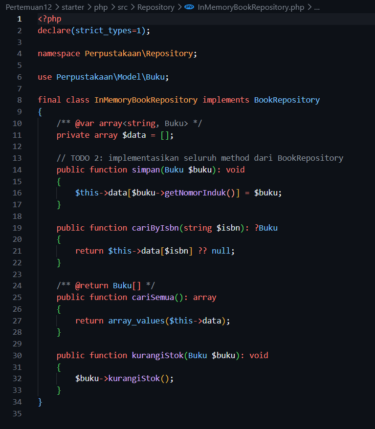

---

### Hasil Eksekusi Program PHP

Skrip utama dijalankan dengan `php main.php` dari folder `Pertemuan12/starter/php`. Hasilnya sesuai skenario yang diharapkan:
- Anggota `A-001` berhasil meminjam ISBN `111`, lalu `A-002` **gagal** karena buku "Laskar Pelangi" sedang dipinjam.
- Peminjaman ISBN `999` **gagal** karena buku tidak ditemukan, dan anggota `X-999` **gagal** karena ID tidak terdaftar.
- `A-001` berhasil meminjam ISBN `222` dua kali, lalu **ditolak** pada percobaan ketiga karena sudah mencapai batas peminjaman (3 buku).
- Laporan fungsional menampilkan daftar buku tersedia, gabungan semua judul, dan jumlah buku per penulis.
- Ekspor ke `laporan_buku.txt` berhasil, dan file ditutup dengan aman melalui blok `finally`.

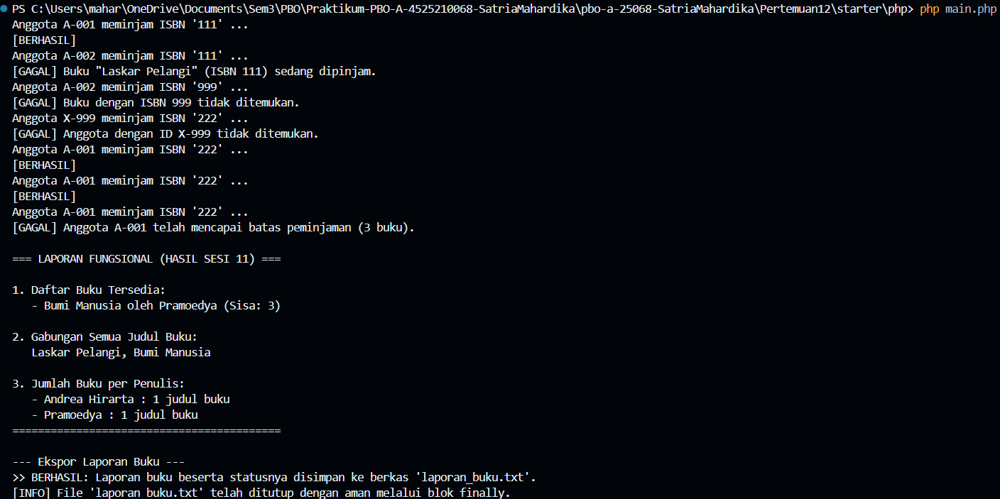
